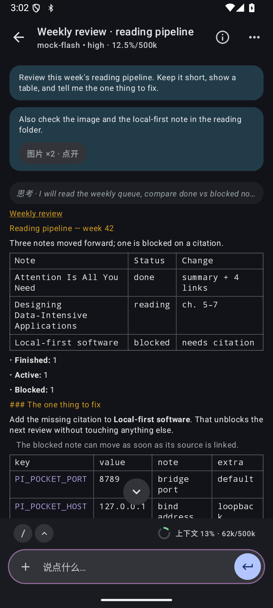

# Pocket Pi

**English** · [中文](#中文)

[](#)
[](#)
[](#)
[](LICENSE)

Pocket Pi is an Android client for **pi** running inside **Termux** on the same phone — or on any machine you can reach over LAN or Tailscale. A native Compose interface talks HTTP + SSE to a small bridge that drives `pi --mode rpc` and keeps a real session on disk.

No remote desktop. No cloud relay. No proprietary memory store.

The bridge can also run as a supervised Termux service: `runsv` restarts it in seconds, with a watchdog fallback for the case where the service directory itself is gone.

**Screenshot tour:** https://ohiyox.github.io/pi-pocket/ · **Source:** https://github.com/OhiyoX/pi-pocket



## Why another client

The terminal is the engine; the phone is the interface. Pocket Pi does not reimplement the agent. It gives pi a native mobile surface while sessions, tools and prompts stay where they already live.

- **Runs on the phone.** Termux hosts the bridge and a real `pi` process. The app connects to `127.0.0.1`.
- **Self-healing bridge.** `runsv` supervises the bridge and restarts a crash in seconds. A watchdog covers `runsvdir` loss; `sv down` is temporary, `sv-disable` is respected.
- **Terminal-parity rendering.** Amber headings, purple inline code, blue links, green tool blocks, square tables — measured against the pi TUI.
- **Built for long turns.** Streaming deltas, collapsible thinking, live tool state, steer or queue while running, stop, auto-reconnect.
- **Many machines, one list.** Loopback, the current subnet and saved hosts; LAN and Tailscale routes to the same host are merged; a sleeping host can be woken over SSH.
- **Session workspace.** Group by project directory, sort, filter, fork, session tree and context ring.
- **Shell and files.** Run commands through the bridge, read files and images, answer extension prompts inline.

## Architecture

```
┌──────────────────── Android ────────────────────┐
│  Pocket Pi app (Kotlin / Compose)                │
│        │  HTTP + SSE  →  127.0.0.1:8789          │
│  termux/pi-pocket-bridge.mjs  (Node)             │
│        │  JSONL over stdio                       │
│  pi --mode rpc   (session / model / tools)       │
│        ▼                                         │
│  ~/.pi/agent/sessions/*.jsonl                    │
└──────────────────────────────────────────────────┘
```

The bridge can also run on a LAN or Tailscale host. The app probes loopback first, then the current `/24`, then saved machines. If the bridge is down, the app can SSH in and start it.

On Termux, `termux/install.sh` registers a `runsv` service, a boot script and a watchdog. `start-bridge.sh` is the single idempotent entry: it uses `sv` when available and starts the launcher directly otherwise.

## Demo

The Pages site is a static, bilingual screenshot tour — no install, bridge or model required:

- https://ohiyox.github.io/pi-pocket/ (English)
- https://ohiyox.github.io/pi-pocket/demo.html (nine screens)

All screenshots were captured from the Android debug build against `tools/mock-bridge.mjs`. Names, paths and conversations are synthetic.

## Quick start

### 1. Bridge in Termux

Prerequisites: Termux with Node 20+, a working `pi` install and git.

```sh
pkg install nodejs git termux-services
git clone https://github.com/OhiyoX/pi-pocket.git
cd pi-pocket
./termux/install.sh
sv up pi-pocket                 # runsv supervision (recommended)
curl -s localhost:8789/v1/health

# no termux-services (POSIX host):
# termux-wake-lock 2>/dev/null
# nohup pi-pocket-start >> ~/.pi/agent/pi-pocket-start.log 2>&1 &
```

### 2. Build the Android app

Prerequisites: JDK 17+ and the Android SDK (API 36).

```sh
./gradlew :app:testDebugUnitTest :app:assembleDebug
adb install -r app/build/outputs/apk/debug/app-debug.apk
```

For the app to start the bridge through Termux, enable external commands in Termux:

```properties
# ~/.termux/termux.properties
allow-external-apps=true
```

### 3. Remote host

```sh
PI_POCKET_HOST=0.0.0.0 \
PI_POCKET_TOKEN="$(openssl rand -hex 16)" \
nohup pi-pocket-bridge >> ~/.pi/agent/pi-pocket-bridge.log 2>&1 &
```

Add the URL or the SSH target in the machine sheet. The app pins the SSH host key on first connect. A non-loopback bind refuses to start without `PI_POCKET_TOKEN`.

## Protocol

| Endpoint | Purpose |
| --- | --- |
| `GET /v1/health` | Host, version, uptime and bridge identity |
| `GET /v1/sessions` | Session files with project directory and size |
| `POST /v1/sessions/open` · `new` | Attach to an existing session or start a fresh worker |
| `GET /v1/messages` | Read the transcript for the current session |
| `POST /v1/prompt` | Send a prompt, optionally with base64 images |
| `POST /v1/abort` | Stop the running turn without killing the session |
| `GET /v1/events` | SSE: deltas, tools, thinking, status |
| `POST /v1/bash` | Run a command on the connected host |
| `GET /v1/info` · `models` · `slash` · `commands` | Model, context, slash commands and capabilities |

See [docs/BRIDGE-API.md](docs/BRIDGE-API.md) for the request/response shapes used by the app.

## Security and limits

- Loopback by default; a non-loopback bind refuses to start without `PI_POCKET_TOKEN`.
- SSH host keys are pinned on first connect; a changed key is rejected.
- The bridge only transports and attributes events. It does not proxy model traffic through a third party.
- No analytics, no telemetry, no cloud relay. The Pages site makes no external requests.
- **Current builds are debug-signed.** Treat the APK as a development artifact, not a store release.
- Tokens and SSH credentials live in app preferences **unencrypted**. Use a device lock and a dedicated token.
- Android loopback is **not** an app isolation boundary: another app on the same device can reach the bridge. Set a token if that matters.
- The in-app self-update panel talks to a self-hosted Gitea instance. The public snapshot uses a placeholder host; configure your own.

## Status

| | |
| --- | --- |
| Version | 0.4.4 · code 23 |
| Min Android | 9 · API 28 |
| Target | API 36 |
| Bridge | Node 20+ · no runtime dependencies |
| Supervision | `runsv` + 15-minute watchdog |
| License | MIT |
| Snapshot | 2026-10-25 |

This repository is a **sanitized public snapshot**. Development, issues and reviews happen in a private upstream; the public repository receives reviewed snapshots. See [PUBLICATION.md](PUBLICATION.md). Public issues and pull requests are welcome and will be ported upstream after review.

## Repository layout

| Path | What it is |
| --- | --- |
| `app/` | Native Android app (Compose / Material 3 Expressive) |
| `termux/` | Termux bridge, launcher, runsv service, watchdog, boot script and tool renderers |
| `tools/mock-bridge.mjs` | Mock bridge used for visual QA and the demo screenshots |
| `demo/` | Static bilingual Pages site (landing + screenshot tour) |
| `docs/` | Architecture, bridge API, testing, terminal parity and design notes |
| `script/` | Node tests for the bridge, launcher, notifications and tool renderers |

## Contributing

Read [CONTRIBUTING.md](CONTRIBUTING.md). Do not include real tokens, private hostnames, customer data or personal vault content in issues, PRs or screenshots. Security issues: see [SECURITY.md](SECURITY.md).

## License

MIT © OhiyoX. See [LICENSE](LICENSE). Third-party notices: [THIRD_PARTY_NOTICES.md](THIRD_PARTY_NOTICES.md).

---

# 中文

**Pocket Pi** 是 **pi** 的 Android 客户端：pi 跑在同一台手机的 **Termux** 里，也可以连局域网或 Tailscale 上的任意机器。原生 Compose 界面通过 HTTP + SSE 连接一个小桥；桥驱动 `pi --mode rpc`，并把真实会话留在磁盘上。

不是远程桌面，也没有云中转，更没有专有记忆库。

桥还可以作为受监督的 Termux 服务运行：`runsv` 秒级拉起崩溃的进程；服务目录本身不在时，由 15 分钟一次的 watchdog 兜底。

**截图导览：** https://ohiyox.github.io/pi-pocket/ · **源码：** https://github.com/OhiyoX/pi-pocket


## 为什么再做一客户端

终端是引擎，手机是界面。Pocket Pi 不重写 Agent，只给 pi 一个原生手机界面；会话、工具与提示词仍留在原来的位置。

- **就在手机里跑。** Termux 承载桥和真正的 `pi` 进程，app 连接 `127.0.0.1`，不需要电脑中转。
- **桥会自愈。** `runsv` 监督桥进程，崩溃后秒级重启；`runsvdir` 不在时由 watchdog 兜底；`sv down` 只是临时停，`sv-disable` 会被尊重。
- **终端口径渲染。** 琥珀标题、紫色行内码、蓝色链接、绿色工具块、方角表格——对照 pi 终端实测。
- **为长回合设计。** 流式增量、可折叠思考、工具实时状态；运行中可 steer 或排队，随时停止，断线自动重连。
- **多台机器，一个列表。** 本机、当前网段与已保存主机；同一台机器的局域网/Tailscale 入口合并；休眠主机可通过 SSH 唤醒。
- **会话工作区。** 按项目目录分组、排序、过滤、分叉、会话树与上下文环。
- **自带 Shell 与文件。** 通过桥执行命令、查看文件与图片，扩展交互请求就地应答。

## 架构

```
┌──────────────── Android ────────────────────────┐
│  Pocket Pi app（Kotlin / Compose）               │
│        │  HTTP + SSE  →  127.0.0.1:8789          │
│  termux/pi-pocket-bridge.mjs（Node）             │
│        │  JSONL over stdio                       │
│  pi --mode rpc（会话 / 模型 / 工具）             │
│        ▼                                         │
│  ~/.pi/agent/sessions/*.jsonl                    │
└──────────────────────────────────────────────────┘
```

桥也可以跑在局域网或 Tailscale 主机上。app 先探测本机，再扫当前 `/24`，最后试已保存机器；桥没起时可以 SSH 进去拉起。

在 Termux 上，`termux/install.sh` 会注册 `runsv` 服务、开机脚本和 watchdog；`start-bridge.sh` 是唯一的幂等入口：有服务用 `sv`，没有服务才直起启动器。

## Demo

Pages 是静态中英双语截图导览，不需要安装、起桥或模型：

- https://ohiyox.github.io/pi-pocket/（中文/英文可切换）
- https://ohiyox.github.io/pi-pocket/demo.html（九屏导览）

所有截图都来自 Android debug 构建，连接 `tools/mock-bridge.mjs` 实拍；名称、路径与会话均为合成数据。

## 快速开始

### 1. 在 Termux 起桥

前置条件：Termux 与 Node 20+、可用的 `pi`、git。

```sh
pkg install nodejs git termux-services
git clone https://github.com/OhiyoX/pi-pocket.git
cd pi-pocket
./termux/install.sh
sv up pi-pocket                 # runsv supervision (recommended)
curl -s localhost:8789/v1/health

# no termux-services (POSIX host):
# termux-wake-lock 2>/dev/null
# nohup pi-pocket-start >> ~/.pi/agent/pi-pocket-start.log 2>&1 &
```

### 2. 构建 Android app

前置条件：JDK 17+、Android SDK（API 36）。

```sh
./gradlew :app:testDebugUnitTest :app:assembleDebug
adb install -r app/build/outputs/apk/debug/app-debug.apk
```

要让 app 通过 Termux 启动桥，需在 Termux 打开外部命令：

```properties
# ~/.termux/termux.properties
allow-external-apps=true
```

### 3. 连远端主机

```sh
PI_POCKET_HOST=0.0.0.0 \
PI_POCKET_TOKEN="$(openssl rand -hex 16)" \
nohup pi-pocket-bridge >> ~/.pi/agent/pi-pocket-bridge.log 2>&1 &
```

在机器面板里填 URL 或 SSH 目标；首次连接会固定主机密钥。非回环绑定没有 `PI_POCKET_TOKEN` 会拒绝启动。

## 协议

| 端点 | 用途 |
| --- | --- |
| `GET /v1/health` | 主机、版本、运行时长与桥身份 |
| `GET /v1/sessions` | 会话文件、项目目录与大小 |
| `POST /v1/sessions/open` · `new` | 接入已有会话，或新建 worker |
| `GET /v1/messages` | 读取当前会话转录 |
| `POST /v1/prompt` | 发送提示词，可附带 base64 图片 |
| `POST /v1/abort` | 停止当前回合，不杀会话 |
| `GET /v1/events` | SSE：增量、工具、思考与状态 |
| `POST /v1/bash` | 在已连接主机上执行命令 |
| `GET /v1/info` · `models` · `slash` · `commands` | 模型、上下文、斜杠命令与能力 |

请求/响应形状见 [docs/BRIDGE-API.md](docs/BRIDGE-API.md)。

## 安全与边界

- 默认只绑回环；非回环绑定没有 `PI_POCKET_TOKEN` 会拒绝启动。
- SSH 主机密钥首次连接即固定，之后密钥变化会拒绝连接。
- 桥只搬运并归属事件，不把模型流量转给第三方。
- 无统计、无遥测、无云中转；Pages 站点不请求外部资源。
- **当前构建是 debug 签名**，请当作开发产物，不是商店发布版。
- token 与 SSH 凭据存在 app prefs 里，**未加密**；请使用设备锁和专用 token。
- Android 的回环**不是**应用隔离边界：同机其它 app 也能连桥。介意就设 token。
- app 内自更新面板连接自建 Gitea；公开快照使用占位主机，请配置自己的实例。

## 状态

| | |
| --- | --- |
| 版本 | 0.4.4 · code 23 |
| 最低 Android | 9 · API 28 |
| 目标版本 | API 36 |
| 桥 | Node 20+ · 无运行时依赖 |
| 监督 | `runsv` + 15 分钟 watchdog |
| 许可证 | MIT |
| 快照 | 2026-10-25 |

本仓是**脱敏后的公开快照**。开发、Issue 与评审在私有上游完成，公开仓只接收已审核快照，见 [PUBLICATION.md](PUBLICATION.md)。欢迎在公开仓提 Issue / PR；接受后会移植到私有上游并在下一次快照中署名。

## 目录

| 路径 | 是什么 |
| --- | --- |
| `app/` | 原生 Android app（Compose / M3 Expressive） |
| `termux/` | Termux 桥、启动器、runsv 服务、watchdog、开机脚本与工具渲染 |
| `tools/mock-bridge.mjs` | 视觉验收与 Demo 截图用的假桥 |
| `demo/` | 静态中英双语 Pages 站点（落地页 + 截图导览） |
| `docs/` | 架构、桥 API、测试、终端对照与设计说明 |
| `script/` | 桥、启动器、通知与工具渲染的 Node 测试 |

## 参与

先读 [CONTRIBUTING.md](CONTRIBUTING.md)。Issue、PR 与截图中不要包含真实 token、私有主机名、客户数据或个人 Vault 内容。安全问题见 [SECURITY.md](SECURITY.md)。

## 许可证

MIT © OhiyoX。见 [LICENSE](LICENSE)；第三方声明见 [THIRD_PARTY_NOTICES.md](THIRD_PARTY_NOTICES.md)。
